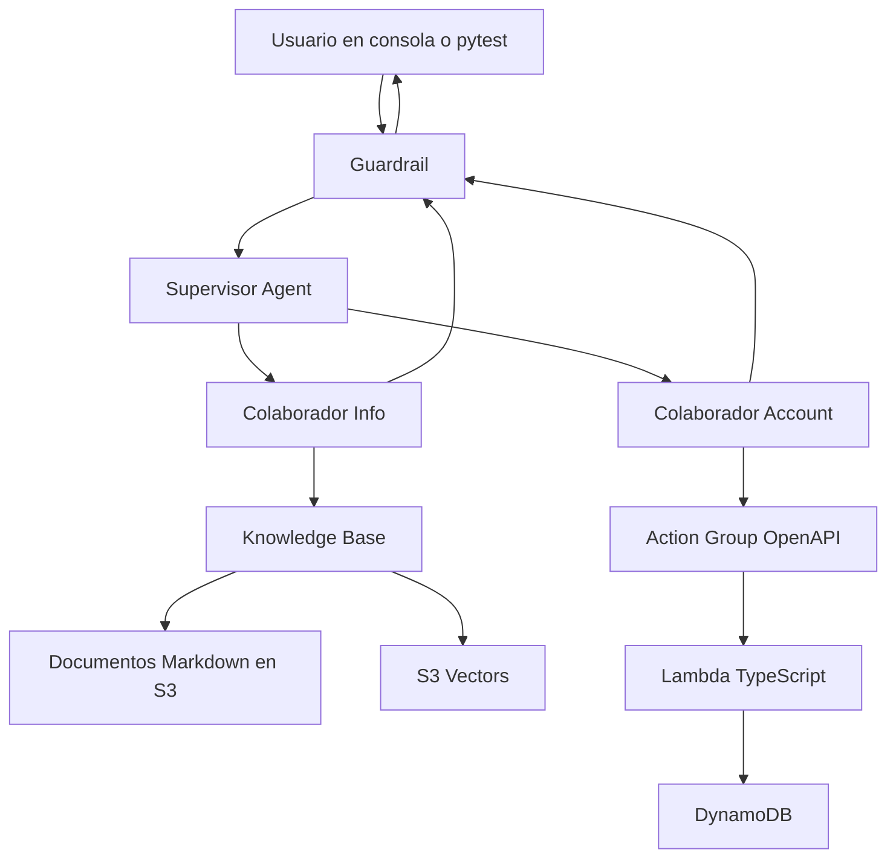

# VirtualSports Support Agent

Agente de soporte al cliente de **VirtualSports**, una plataforma de deportes virtuales (fútbol virtual y carreras de caballos virtuales). El usuario escribe en lenguaje natural. El agente responde con la documentación oficial o ejecuta acciones sobre su cuenta.

El dominio y los datos de cuenta son de ejemplo. El flujo es el de un agente de soporte en producción: orquestación, base de conocimiento, herramientas, controles de seguridad y evaluación de las respuestas.

Se usa desde la consola de Bedrock y desde el script de regresión.

## Capacidades

| Pieza | Rol en el sistema |
| --- | --- |
| Supervisor y dos colaboradores | Enruta cada mensaje a Info, a Account, o a los dos en la misma conversación |
| Knowledge Base | Responde reglas, FAQ y juego responsable desde documentos en S3, indexados en S3 Vectors |
| Action Group | Expone saldo, tickets y límites de depósito con un schema OpenAPI y una Lambda en TypeScript sobre DynamoDB |
| Guardrail | Enmascara PII, bloquea predicciones y tips de apuestas, y comprueba que la respuesta esté apoyada en las fuentes |
| Prompts versionados | `prompts/v1` y `prompts/v2` en git; cada alias del agente apunta a una versión publicada |
| Regresión y A/B | Pytest corre el mismo set de casos contra un alias y compara `v1` con `v2` |
| Modelos | Claude Haiku en la iteración diaria; Claude Sonnet en la comparación de alias |
| RAG | Chunking fijo, Titan Text Embeddings V2, y tests que comprueban el documento recuperado |
| Operación | Trazas de orquestación, permisos mínimos y un informe de acierto, retrieval y latencia |

Más adelante el mismo canal puede sumar Bedrock AgentCore, Amazon Agent Assist o voz con Nova Sonic.

## Plataforma

El runtime es **Amazon Bedrock Agents**.

- El supervisor hace el routing y los handoffs.
- La Knowledge Base hace el retrieval.
- El Action Group llama a la Lambda.
- El Guardrail filtra entrada y salida.
- Los alias apuntan a versiones inmutables del agente.

La lógica de negocio propia está en la Lambda de fulfillment (TypeScript) y en el arnés de evaluación (Python).

## Alcance

El agente cubre:

- Conversación en español sobre reglas de juego, FAQ de cuenta y juego responsable.
- Estado de un ticket, saldo y cambio de límite de depósito sobre datos de ejemplo.
- Preguntas que piden documentación y una acción en la misma conversación.
- Bloqueo de predicciones y tips de apuestas.
- Enmascarado de PII y comprobación de grounding.
- Dos versiones de prompt comparadas con el mismo set de casos.

La interfaz de usuario, la voz, AgentCore y los pagos reales quedan para una etapa posterior. Los recursos de AWS se crean en consola. Los documentos, los prompts, la Lambda, la semilla de datos y los tests viven en este repositorio.

## Arquitectura



Cada sesión llega con `userId` en los atributos de sesión. El agente usa esa identidad y no se la pide al usuario. Si la persona escribe datos personales en el mensaje, el guardrail los enmascara.

Cuenta de referencia: `usr_demo_001`.

## Funcionalidad

### Informar

El colaborador Info responde solo con la Knowledge Base.

- Cómo funcionan las carreras de caballos virtuales.
- Reglas del fútbol virtual (duración, empates, mercados que ofrece la plataforma).
- Cómo ver un ticket, qué significa cada estado y cómo cambiar un límite de depósito.
- Juego responsable: qué es un límite, periodos permitidos y topes.

Si la base no tiene evidencia, el agente lo dice y deja la pregunta sin completar con conocimiento general.

### Operar la cuenta

El colaborador Account ejecuta tres acciones. Los parámetros salen del mensaje del usuario. `userId` sale de la sesión.

| Acción | Entrada | Efecto |
| --- | --- | --- |
| `getTicketStatus` | `ticketId` | Devuelve estado, asunto y fecha del ticket de ese usuario |
| `getBalance` | ninguna extra | Devuelve saldo, moneda y límites vigentes |
| `setDepositLimit` | `period`, `amount` | Valida el tope y persiste el límite |

Reglas que la Lambda hace cumplir, alineadas con el documento de juego responsable:

- `period`: `daily`, `weekly` o `monthly`.
- `amount`: número mayor o igual a 0. `0` deja el límite en cero.
- Topes: 100 diario, 500 semanal, 1 500 mensual. Por encima del tope la Lambda rechaza y devuelve el motivo. El agente explica ese motivo.

### Combinar documentación y acción

El supervisor puede consultar a los dos colaboradores en un mismo turno.

Ejemplo: “¿cómo funcionan las carreras virtuales y en qué estado está mi ticket 123?”

Ejemplo de política más acción: “quiero un límite de depósito diario de 40”. Info explica la norma y Account aplica el cambio. La Lambda es la fuente de verdad del escrito. La Knowledge Base es la fuente de verdad de la explicación.

### Límites del sistema

- Predicciones, pronósticos y tips de apuesta, también si llegan como “análisis” o “¿quién gana?”.
- PII escrita por el usuario (email, teléfono, documento, número de tarjeta): se enmascara en el procesamiento.
- Ticket inexistente, ticket de otro usuario, importe inválido o periodo inválido: la herramienta devuelve un error de negocio y el agente lo traduce sin inventar un estado.
- Preguntas ajenas a VirtualSports: el supervisor responde que solo cubre la plataforma.

## Agentes y prompts

Tres agentes. Cada uno tiene instrucciones propias, cortas y comprobables.

**Supervisor.** Elige el colaborador. Su instrucción define cuándo usar Info, cuándo usar Account y cuándo los dos. El contenido de negocio lo dan los colaboradores. Ante un tema denegado, deja que el guardrail cierre el turno.

**Info.** Solo Knowledge Base. Cita la base. Si el retrieval viene vacío o el grounding falla, responde que esa información no está en la documentación.

**Account.** Solo Action Group. Las reglas largas las explica Info. Account traduce el resultado de la Lambda, incluidos los rechazos, y no calcula saldos ni estados por su cuenta.

Los prompts viven en git:

```text
prompts/v1/supervisor.md
prompts/v1/info.md
prompts/v1/account.md
prompts/v2/supervisor.md
prompts/v2/info.md
prompts/v2/account.md
```

`v1` es la línea base: routing, cita de fuentes y uso de herramientas.

`v2` ajusta dos comportamientos. El supervisor, en una pregunta mixta, completa las dos partes. Info se abstiene cuando la cita no cubre la pregunta. El diff entre versiones queda registrado junto a la corrida en `results/`.

Cada versión publicada del agente en Bedrock es inmutable. Un alias apunta a una versión:

- alias `v1` → versión creada con los prompts `prompts/v1`
- alias `v2` → versión creada con los prompts `prompts/v2`

Pytest llama siempre a un alias.

Modelos, definidos en configuración:

- Iteración y regresión diaria: Claude Haiku en Bedrock.
- Comparación de `v1` contra `v2`: Claude Sonnet en Bedrock, el mismo set, los dos alias.

Temperatura 0 en ambos, para que la diferencia entre alias venga del prompt y del routing.

## Knowledge Base

Cuatro documentos markdown en `knowledge/`:

| Archivo | Contenido |
| --- | --- |
| `virtual-football.md` | Duración de los partidos virtuales, qué se liquida, empates, mercados de la plataforma |
| `virtual-horse-racing.md` | Cómo se genera una carrera, lectura de resultados, diferencia entre carrera virtual y carrera real |
| `account-faq.md` | Tickets, estados (`open`, `pending`, `resolved`, `closed`), saldo y qué puede hacer el usuario desde soporte |
| `responsible-gaming.md` | Límites de depósito, periodos, topes y pausa de juego. Soporte no da pronósticos |

Decisiones de RAG, fijas para que el retrieval sea repetible:

- **Almacén vectorial:** S3 Vectors, asociado a la Knowledge Base. El corpus cabe en un solo índice.
- **Embeddings:** Amazon Titan Text Embeddings V2, 1 024 dimensiones. Cubre español y se gestiona dentro de Bedrock. Cohere Embed queda como alternativa si el corpus pasa a ser multilingüe y hace falta comparar calidad de retrieval.
- **Chunking:** tamaño fijo, 300 tokens, 20 % de solapamiento. El corpus es corto y curado, y los cortes estables mantienen fiable el test de retrieval. Cada documento abre con un título estable para identificar la fuente.
- **Sincronización:** un data source de S3. Tras editar un markdown se relanza la ingesta antes de evaluar.

La evaluación de retrieval va aparte de la evaluación de la respuesta. Un caso de Info declara el documento esperado (`expected_source`). El test revisa la traza de la Knowledge Base y comprueba que ese archivo aparece entre las citas. Así se separa un fallo de retrieval de un fallo de redacción.

## Action Group y datos

Schema en `openapi/account-actions.yaml`, OpenAPI 3.0, un path por acción, tipos explícitos y descripciones que el modelo usa para elegir la operación. El Action Group usa fulfillment por Lambda.

Lambda en `lambda/account-actions/`, TypeScript. El handler despacha por nombre de operación según el evento de Bedrock Agents y responde en el envelope que el agente espera.

Tabla DynamoDB de una sola tabla:

- Clave de partición: `userId`
- Clave de ordenación: `PROFILE` o `TICKET#<id>`
- Índice secundario por `ticketId` para `getTicketStatus`

Semilla en `scripts/seed_dynamodb.py` para `usr_demo_001`:

- Saldo de referencia: 250.00 USD.
- Límites iniciales por debajo de los topes.
- Tickets `123` (`open`), `456` (`pending`) y `789` (`resolved`), con asunto y fecha.
- Un ticket de otro usuario, para comprobar que `getTicketStatus` solo devuelve tickets de la sesión.

La Lambda registra el nombre de la operación y el resultado, sin volcar PII en los logs.

## Guardrails

Un guardrail asociado al supervisor y a los dos colaboradores, en entrada y en salida.

- **PII:** enmascara email, teléfono, nombre, dirección, documento de identidad y números de tarjeta o cuenta. El `userId` de sesión no se pide ni se repite al usuario.
- **Tema denegado:** predicciones, pronósticos o tips de apuestas sobre eventos virtuales o reales. La definición incluye ejemplos (“¿quién gana la próxima carrera?”, “dame un tip”).
- **Contextual grounding:** umbrales de grounding y de relevancia en las respuestas apoyadas en la Knowledge Base. Si el chequeo falla, la respuesta no se entrega como hecho.
- **Filtros de contenido** de Bedrock (odio, insultos, violencia, conducta indebida) en nivel medio.

Esos casos forman parte del set de regresión. El resultado esperado es la intervención del guardrail.

## Evaluación

Set único en `tests/cases.yaml`, de 18 a 20 casos. Cada caso tiene id, mensaje de usuario, tipo y expectativa. La expectativa es comprobable en la traza o en hechos concretos:

- `expected_source`: archivo de la Knowledge Base que debe aparecer en las citas.
- `expected_tool`: acción que debe aparecer en la traza (`getTicketStatus`, `getBalance`, `setDepositLimit`).
- `expected_facts`: datos que la respuesta debe contener (estado `open`, saldo, límite aplicado).
- `expected_guardrail`: el turno debe bloquearse por tema denegado, PII o grounding.
- `expected_collaborators`: en los casos mixtos, Info y Account deben intervenir.

Distribución del set:

- 6 de información, cubriendo los cuatro documentos.
- 5 de una sola herramienta, incluyendo ticket ajeno o inexistente y límite por encima del tope.
- 3 mixtos.
- 3 de tema denegado, con al menos uno que presenta el tip como análisis.
- 2 de PII o de pregunta fuera de dominio.

`tests/test_regression.py` invoca el agente contra el alias de `AGENT_ALIAS`. Lee la traza y el texto final. Pytest marca cada caso como pasado o fallido.

`tests/test_ab.py` corre el mismo archivo contra `v1` y `v2` y escribe un resumen:

- tasa de acierto por tipo de caso
- acierto de herramienta
- acierto de fuente recuperada
- intervenciones de guardrail correctas
- latencia media por alias

El resumen se guarda en `results/` y se incorpora a este README tras cada corrida.

## Seguridad y operación

- Rol de cada agente con permiso mínimo: Info lee la Knowledge Base; Account invoca solo su Lambda; la Lambda lee y escribe solo su tabla.
- La Lambda usa el `userId` de la sesión. Si el modelo envía otro, la operación se rechaza.
- Cifrado en reposo con las claves de AWS en S3, S3 Vectors y DynamoDB.
- Trazas de Bedrock activadas: routing, retrieval y herramientas.
- Logs de Lambda en CloudWatch, con operación y código de resultado.
- Temperatura 0, alias inmutables y semilla de datos reproducible.

## Estructura del repositorio

```text
knowledge/                 documentos de la Knowledge Base
prompts/v1/                instrucciones de la versión v1
prompts/v2/                instrucciones de la versión v2
openapi/account-actions.yaml
lambda/account-actions/    fulfillment en TypeScript
scripts/seed_dynamodb.py   datos de ejemplo
tests/cases.yaml
tests/test_regression.py
tests/test_ab.py
results/                   salidas de las corridas
README.md
```

Recursos en consola, en orden de dependencia:

1. Bucket S3 con `knowledge/` y Knowledge Base en S3 Vectors (Titan V2, chunking fijo).
2. Agente Info asociado a esa base.
3. Tabla DynamoDB, semilla y Lambda.
4. Schema OpenAPI, agente Account y Action Group.
5. Guardrail, probado con un tip y con un email.
6. Supervisor con Info y Account como colaboradores, guardrail asociado y trazas activas.
7. Versión publicada y alias `v1`, con los prompts en `prompts/v1`.
8. Prompts `v2`, alias `v2`, regresión y comparación.

## Comportamiento esperado

- Cada documento de la base responde con cita, y el test de fuente pasa.
- Las tres acciones devuelven datos de la semilla o un rechazo de negocio claro.
- Una pregunta mixta deja en la traza a los dos colaboradores.
- Un tip de apuesta lo detiene el guardrail.
- Un email en el mensaje queda enmascarado.
- `pytest` pasa contra el alias `v1`.
- La corrida con Sonnet deja en `results/` el resumen de `v1` contra `v2`.
